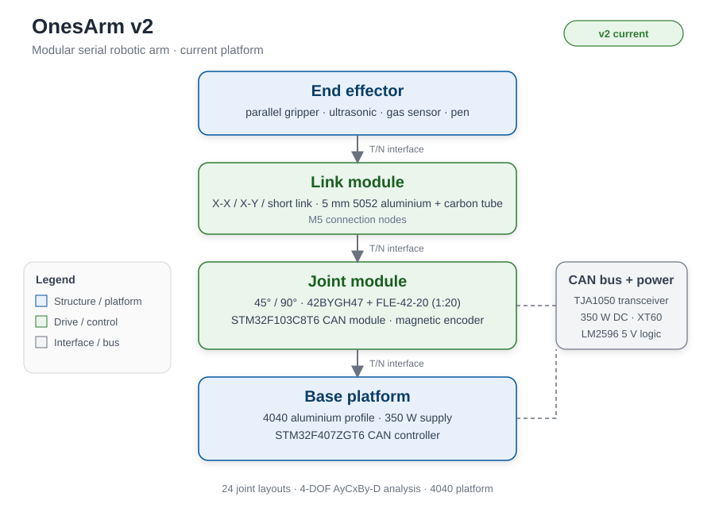

<p align="center">
  
</p>

<h1 align="center">OnesArm (珠联“臂”合)</h1>

<p align="center">
  <strong>Bras robotique série modulaire pour des tâches multi-scénarios</strong>
  <br>
  Plateforme v2 pas à pas/CAN, 24 configurations articulaires et interfaces tenon-mortaise
</p>

<p align="center">
  <a href="./LICENSE.md"></a>
  <a href="./LICENSE-docs.md"></a>
  
  
  
  
</p>

<p align="center">
  <a href="./README.md">English</a> |
  <a href="./README.zh-CN.md">中文</a> |
  <a href="./README.fr.md">Français</a>
</p>

---

## À propos du projet

**OnesArm** (titre chinois : 珠联“臂”合) est un bras robotique série modulaire. **La v2 est la plateforme actuelle.** Elle associe des moteurs pas à pas 42BYGH47 à des réducteurs planétaires FLE-42-20, des modules CAN STM32F103C8T6, un contrôleur de bus STM32F407ZGT6, une alimentation de 350 W et une plateforme en profilé aluminium 4040. Les bielles utilisent une tôle d’aluminium 5052 de 5 mm et des tubes en fibre de carbone de 50 × 46 mm, reliés par des nœuds M5 normalisés.

Le bras s’assemble à partir de modules d’articulation, de bielle et d’effecteur interchangeables via des interfaces **T/N à tenon et mortaise**. Pour la configuration à trois modules, l’orientation adjacente à la base est fixe et les deux autres modules choisissent l’un de deux canaux perpendiculaires, ce qui donne

**N₃ = 3! × 2² = 24**

configurations articulaires. Les 24 assemblages sont modélisés dans SolidWorks.

La **configuration de référence v1**, avec servomoteurs PWM de 15 kgf·cm et Raspberry Pi Pico W, est conservée dans le dépôt pour comparaison. Le projet a été développé par 郭沫晗 (Guo Mohan) au lycée n° 1 de Guyuan, Ningxia. Le rapport mentionne un premier prix au 38e Concours national chinois d’innovation scientifique et technologique des jeunes (2024).

> **Note de plateforme.** La v1 et la v2 utilisent des systèmes électroniques distincts. Sélectionner l’ensemble moteur et cartes correspondant avant l’assemblage.

## Caractéristiques principales

- **Chaîne d’entraînement v2 pas à pas/CAN** — moteurs 42BYGH47, réducteurs FLE-42-20 1:20, commande en boucle fermée par encodeur magnétique et modules CAN STM32F103C8T6.
- **Structure v2 aluminium/carbone** — bielles en 5052 de 5 mm, tubes carbone de 50 × 46 mm, nœuds M5, plateforme 4040 et alimentation 350 W, avec sources SolidWorks, STEP et STL.
- **24 configurations reconfigurables** — trois modules interchangeables, deux canaux perpendiculaires et orientation adjacente à la base fixe.
- **Interface T/N à tenon et mortaise** — nœud T en haut, nœud N en bas, serrage par vis M5, inspirée de la queue d’aronde et de l’assemblage à mi-bois.
- **Configuration de référence v1** — servomoteurs PWM de 15 kgf·cm, Raspberry Pi Pico W, cinq cartes de module et interconnexion peigne 16P.
- **Effecteurs multi-scénarios** — pince parallèle, sonde HC-SR04, capteur de gaz MQ et module stylo sur la même interface.

## Architecture du système

### Plateforme v2 actuelle

<p align="center">
  
  <br>
  <em><strong>Architecture système.</strong> Effecteur, module de bielle, module d’articulation et plateforme 4040, avec le bus CAN et l’alimentation 350 W.</em>
</p>


| Sous-système | Implémentation v2 |
|---|---|
| Contrôleur | Contrôleur de bus CAN STM32F407ZGT6 ; module CAN STM32F103C8T6 dans chaque articulation |
| Entraînement | Moteur pas à pas 42BYGH47 + réducteur planétaire FLE-42-20, 1:20 ; boucle fermée par encodeur magnétique |
| Bus et alimentation | CAN via TJA1050 ; alimentation 350 W ; entrée XT60 ; rail logique LM2596-5.0 |
| Structure | Tôle aluminium 5052 de 5 mm + tubes carbone 50 × 46 mm ; nœuds M5 ; plateforme aluminium 4040 |
| Effecteurs | Pince parallèle, sonde HC-SR04, capteur de gaz MQ, module stylo |

<p align="center">
  
  
  <br>
  <em><strong>Figure 1 — Bielles longues v2.</strong> Bielles X-X et X-Y en aluminium 5052 de 5 mm avec tubes carbone de 50 × 46 mm et nœuds M5.</em>
</p>

<p align="center">
  
  
  <br>
  <em><strong>Figure 2 — Module d’entraînement et plateforme v2.</strong> Moteur 42BYGH47, réducteur FLE-42-20, carte CAN et plateforme aluminium 4040.</em>
</p>

### Configuration de référence v1

| Sous-système | Implémentation v1 |
|---|---|
| Contrôleur | Raspberry Pi Pico W, RP2040, Wi-Fi |
| Entraînement | Servomoteur numérique PWM 15 kgf·cm |
| Bus | Interconnexion peigne 16P 2,54 mm |
| Cartes | Base, Joint A, Joint B, Holder/Sensor, Expand Controller |
| Alimentation | Rail servo 5–9 V ; logique 5 V |

<p align="center">
  
  
  <br>
  <em><strong>Figure 3 — Configuration de référence v1.</strong> Rendu du bras à servomoteurs et carte Joint Module avec sorties PWM, LED d’état et sélecteur de signal servo.</em>
</p>

## Théorie et conception

### Combinaisons modulaires

L’interface modulaire est une chaîne **face de connexion – canal de connexion – face de connexion** (FCF). Une bielle longue X-X ou X-Y a 6 faces × 4 canaux, une bielle courte 4 × 4 et une articulation 2 × 4. Les nombres de méthodes par module sont :

- Base : 3 méthodes.
- Bielles longues X-X / X-Y : 2 × 3 × 3 = 18 méthodes.
- Bielle courte : 2 × 2 × 3 = 12 méthodes.
- Articulation : côté Pro 4 × 1 × 1 = 4, côté Con 1 × 4 × 1 = 4, soit 8 par module d’articulation.
- Bielle terminale générale : 2 × 2 ou 2 × 3 méthodes.

Pour <i>F</i> modules d’articulation, <i>N</i><sub>LL</sub> bielles longues et <i>N</i><sub>LS</sub> bielles courtes, le total FCF vaut :

$$\displaystyle N_{com} = \sum_{i=0}^{N_{LL}} \sum_{j=0}^{N_{LS}} 8^{F} \cdot 18^{N_{LL}} \cdot 12^{N_{LS}}$$

L’assemblage à trois modules fixe l’orientation adjacente à la base et donne aux deux autres modules deux canaux perpendiculaires chacun :

$$N_3 = 3! \cdot 2^{3-1} = 24$$

Les 24 combinaisons sont modélisées dans SolidWorks.

<p align="center">
  
  
  <br>
  <em><strong>Figure 4 — Abstraction FCF.</strong> Chaque connexion est une face, un canal et une autre face. Les bielles longues ont six faces, les bielles courtes quatre, les articulations deux.</em>
</p>

### Cinématique et espace de travail

La configuration analysée est **AyCxBy-D**, une chaîne à 4 DDL. La table 3-20 du rapport donne :

| i | dᵢ (mm) | aᵢ (mm) | αᵢ | Plage du rapport |
|---:|---:|---:|---:|---|
| 1 | 95 | 0 | 90° | 0° |
| 2 | 0 | 113.5 | 90° | 0–180° |
| 3 | 21.34 | 88.5 | 90° | 0–180° |
| 4 | 0 | 152 | 0° | 0–180° |

La transformation DH standard est :

$$T_i^{i-1} = \begin{bmatrix}
c\theta_i & -s\theta_i c\alpha_i & s\theta_i s\alpha_i & a_i c\theta_i \\
s\theta_i & c\theta_i c\alpha_i & -c\theta_i s\alpha_i & a_i s\theta_i \\
0 & s\alpha_i & c\alpha_i & d_i \\
0 & 0 & 0 & 1
\end{bmatrix}, \qquad T_4^0 = T_1^0 T_2^1 T_3^2 T_4^3$$

L’espace de travail est l’ensemble des positions de l’outil sur les plages articulaires :

$$\mathcal{W} = \left\{ \mathbf{p}(q) \mid q_i \in [q_{i,\min}, q_{i,\max}] \right\}, \qquad \mathbf{p}(q) = [T_4^0(q)]_{1:3,4}$$

La somme des bielles vaut 113.5 + 88.5 + 152 = 354 mm. Avec les décalages du modèle, l’espace de travail échantillonné atteint environ 450 mm.

<p align="center">
  
  <br>
  <em><strong>Figure 5 — Comparaison des espaces de travail.</strong> Quatre des 24 configurations : AyCxBy-D, AyCyBx-D, AyCxBx-D et AyCyBy-D. Échantillons de simulation du modèle cinématique.</em>
</p>

### Analyse par éléments finis v2

La bielle longue XY v2 est évaluée comme un assemblage statique. La connexion de base est encastrée et la charge de service est appliquée aux nœuds de connexion. Le modèle associe les tôles aluminium 5052 de 5 mm au tube carbone de 50 × 46 mm.

La solution éléments finis s’écrit :

$$K u = f$$

où K est la matrice de rigidité, u le vecteur des déplacements nodaux et f le vecteur des charges nodales. Le même chemin de charge peut être vérifié par les relations de poutre console :

$$M = FL, \qquad \sigma = \frac{Mc}{I}, \qquad \delta = \frac{FL^3}{3EI}$$

L’étude v2 donne une carte du déplacement (URES) dont le maximum vaut :

$$u_{\max} = 1.388 \times 10^{-2}\ \text{mm}$$

<p align="center">
  
  <br>
  <em><strong>Figure 6 — Analyse par éléments finis v2.</strong> Carte de déplacement statique de la bielle longue XY. La base est encastrée et les nœuds de connexion portent la charge de service ; la légende URES est en millimètres.</em>
</p>

### Sélection d’assemblage

Le panneau v2 utilise l’intégrale absolue de la vitesse articulaire comme indice de sélection :

$$E_{Sum} = \sum_{i=1}^{F} \left| \int_0^t \dot{\theta}_i(\tau)\,d\tau \right|$$

La sélection compare E_Sum à l’enveloppe de travail. Le flux est :

<p align="center">
  
  <br>
  <em><strong>Figure 7 — Flux de sélection d’assemblage v2.</strong> Indice d’effort et prétraitement de l’espace de travail.</em>
</p>

### Analyse statique de la configuration de référence v1

L’analyse statique v1 utilise la résine photopolymère 9400A et une charge de 10 N sur chaque face supérieure d’articulation. Les boîtiers d’articulation et l’assemblage complet sont évalués dans SolidWorks Simulation.

<p align="center">
  
  
  <br>
  <em><strong>Figure 8 — Analyse statique de la référence v1.</strong> Maillage et contrainte du boîtier d’articulation sous une charge de 10 N.</em>
</p>

## Structure du dépôt

```text
OnesArm/
├── BOM/                    synthèse + listes de fabrication
├── electronics/            sorties Gerber, BOM et sérigraphie
├── mechanical/
│   ├── source/             pièces et assemblages SolidWorks
│   ├── output/             exports STEP, STL et fabrication
│   └── analysis/fea/       images EF exportées
├── firmware/               projets STM32CubeIDE + bibliothèques MicroPython
├── software/               scripts MATLAB de cinématique
├── docs/
│   ├── en/ zh-CN/ fr/      documentation longue
│   ├── report/             rapport 2025 et soutenance
│   ├── archive/            rapport 2024 et journal de recherche
│   └── references/         citations et provenance
├── media/
│   ├── photos/project/     rendus v2, photos v1, PCB et vues d’essai
│   ├── photos/reference/   figures du rapport et figures clés
│   ├── gifs/               démonstrations de la configuration v1
│   ├── videos/             fichiers MP4 originaux
│   └── source/             fichiers de panneaux éditables
├── data/                   répertoire de données et journaux
├── scripts/verify_theory/  vérifications Python de cinématique et dimensions
├── README.md README.zh-CN.md README.fr.md
├── MIGRATION_NOTES.md CHANGELOG.md CONTRIBUTING.md
├── LICENSE.md LICENSE-docs.md
├── .gitignore .gitattributes
└── .github/
```

## Nomenclature

Une synthèse est dans [`BOM/onesarm_bom.md`](BOM/onesarm_bom.md), la version lisible par machine dans [`BOM/onesarm_bom.csv`](BOM/onesarm_bom.csv). Les listes originales sont dans [`BOM/manufacturing/`](BOM/manufacturing/).

### Plateforme v2 actuelle

| Groupe | Éléments v2 | Quantité |
|---|---|---|
| Bielles longues | X-X et X-Y, aluminium 5052 de 5 mm + tube carbone | 4 + 4 |
| Bielles courtes | Aluminium 5052 de 5 mm | 4 |
| Articulations | 45° × 1, 90° × 2 | 3 |
| Entraînement | 42BYGH47 + FLE-42-20, 1:20 | 3 ensembles |
| Commande | Modules CAN STM32F103C8T6 + contrôleur STM32F407ZGT6 | 1 ensemble |
| Alimentation | 350 W continu, XT60 | 1 |
| Plateforme | Profilé aluminium 4040, trois plaques d’essai | 1 |
| Effecteurs | Pince, ultrasons, capteur de gaz, stylo | 4 modules |

### Configuration de référence v1

| Groupe | Éléments v1 | Quantité |
|---|---|---|
| Entraînement | Servomoteur PWM 15 kgf·cm | 3 |
| Contrôleur | Raspberry Pi Pico W | 1 |
| Cartes de module | Base, Joint A/B, Holder/Sensor, Expand Controller | 5 |
| Interconnexion | Peigne 16P 2,54 mm | Selon besoin |
| Articulations imprimées | Boîtiers en résine 9400A | 3 + 3 |

## Démarrage

### Assemblage v2

1. **Fabriquer la structure.** Utiliser les STEP/STL de `mechanical/output/`, découper et plier les bielles 5052 de 5 mm, coller les tubes carbone 50 × 46 mm et imprimer les boîtiers 9400A.
2. **Fabriquer l’électronique.** Commander les Gerber de `electronics/output/gerber/controller_monitor/` et monter la nomenclature de `electronics/output/bom/controller_monitor/`.
3. **Assembler la plateforme.** Construire le cadre 4040, installer l’alimentation 350 W et fixer les cartes Controller et Monitor.
4. **Configurer la commande.** Ouvrir les projets STM32CubeIDE de `firmware/stm32/` et configurer le bus CAN et les modules d’articulation pour la configuration choisie.
5. **Lancer l’analyse.** Utiliser les scripts MATLAB de `software/matlab/kinematics/` et les vérifications Python de `scripts/verify_theory/`.

```bash
python scripts/verify_theory/report_checks.py
python -m unittest discover -s scripts/verify_theory -v
```

### Assemblage de référence v1

1. Imprimer les boîtiers v1 et assembler les cinq cartes de module v1.
2. Commander les Gerber de `electronics/output/gerber/v1_module_boards/` et réaliser le faisceau peigne 16P.
3. Flasher le Pico W avec les bibliothèques MicroPython de `firmware/micropython/` et connecter le rail servo.

## Démonstration et essais

Les vues CAO et plateforme v2 présentent la structure et l’ensemble d’entraînement actuels.

<p align="center">
  
  <br>
  <em><strong>Figure 9 — Plateforme de travail v2.</strong> Bras à moteurs pas à pas, bielles aluminium/carbone et cadre 4040.</em>
</p>

Les démonstrations de la configuration de référence v1 montrent le bras servo/Pico en mouvement, l’écran OLED/GNSS du contrôleur d’extension, la pince/le module stylo et la vue de simulation.

<p align="center">
  
  
</p>

<p align="center">
  
  
</p>

<p align="center">
  
  
  
  <br>
  <em><strong>Figure 10 — Configuration de référence v1 et vues d’assemblage.</strong> Configuration servo/Pico, empilement de modules et les 24 combinaisons permutation/orientation.</em>
</p>

## Spécifications

### Plateforme v2 actuelle

| Paramètre | Valeur | Source |
|---|---|---|
| Configuration analysée | AyCxBy-D, 4 DDL | Rapport §3.3 |
| Longueurs d₁, a₂, d₃, a₃, a₄ | 95 ; 113,5 ; 21,34 ; 88,5 ; 152 mm | Rapport table 3-20 |
| Somme des bielles | 354 mm | Calcul |
| Portée maximale du modèle | environ 450 mm | Calcul, 10 000 échantillons |
| Assemblages | 24 combinaisons | 3! × 2² ; 24 fichiers CAO |
| Entraînement | 42BYGH47 + FLE-42-20, 1:20 | Rapport §5.2.2 |
| Contrôleur | STM32F103C8T6 CAN + STM32F407ZGT6 | Rapport §5.2.2 / §5.2.3 |
| Plateforme | Profilé aluminium 4040, alimentation 350 W | Rapport §5.2.3 |
| Structure | Tôle aluminium 5052 de 5 mm + tube carbone 50 × 46 mm | Rapport §5.2.1 |
| Matériau EF | Résine 9400A, E = 2.75 GPa, ν = 0.44, 1150 kg/m³ | Rapport table 3-1 |
| Charge EF | 10 N sur chaque face supérieure d’articulation | Rapport §3.1.2 |

### Configuration de référence v1

| Paramètre | Valeur | Source |
|---|---|---|
| Entraînement | Servomoteur PWM 15 kgf·cm, 5–9 V, 180° | Rapport §2.3.1 |
| Contrôleur | Raspberry Pi Pico W, RP2040 | Rapport §2.3.2 |
| Cartes de module | Base, Joint A/B, Holder/Sensor, Expand Controller | Rapport §2.3.2 |
| Interconnexion | Peigne 16P 2,54 mm | Rapport §2.3.2 |
| Alimentation logique | 5 V | Rapport §2.3.2 |

## Documentation

- [Principe de fonctionnement](docs/fr/theory_of_operation.md)
- [Conception mécanique](docs/fr/mechanical_design.md)
- [Électronique et commande](docs/fr/electronics_and_control.md)
- [Assemblage et reproduction](docs/fr/assembly_and_replication.md)
- [Vérification](docs/verification.md)
- [Glossaire](docs/glossary.md)

Les versions anglaise et chinoise sont dans [`docs/en/`](docs/en/) et [`docs/zh-CN/`](docs/zh-CN/).

## Contribution

Voir [`CONTRIBUTING.md`](CONTRIBUTING.md). Ajouter la source et la licence des figures tierces.

## Licence

- **Code, firmware et scripts :** [MIT](LICENSE.md).
- **Documentation, CAO originale, photos et schémas :** [CC BY 4.0](LICENSE-docs.md).
- **Figures, articles, vidéos et marques tierces :** exclus des deux licences. Voir [`docs/references/README.md`](docs/references/README.md).

## Remerciements

- **Auteur :** 郭沫晗 (Guo Mohan), lycée n° 1 de Guyuan, Ningxia.
- **Enseignants et mentors :** 马博伟 (atelier de robotique du lycée), 杨旭 (Université des sciences et technologies électroniques de Chine), 邵金龙 (Université du Ningxia), selon les remerciements du rapport.
- **Concours :** 38e Concours national chinois d’innovation scientifique et technologique des jeunes (2024).
- **Références :** littérature sur les robots continus, les bras modulaires, les assemblages tenon-mortaise et les robots serpentins, listée dans [`docs/references/README.md`](docs/references/README.md).
- **Outils :** SolidWorks, MATLAB Robotics Toolbox, EasyEDA/LCEDA, STM32CubeIDE, MicroPython, ffmpeg et Pillow.
