<p align="center">
  
</p>

<h1 align="center">OnesArm（珠联“臂”合）</h1>

<p align="center">
  <strong>面向多场景的模块化串联机械臂</strong>
  <br>
  v2 步进+CAN 平台，24 种关节布局，榫卯式接口
</p>

<p align="center">
  <a href="./LICENSE.md"></a>
  <a href="./LICENSE-docs.md"></a>
  
  
  
  
</p>

<p align="center">
  <a href="./README.md">English</a> |
  <a href="./README.zh-CN.md">中文</a> |
  <a href="./README.fr.md">Français</a>
</p>

---

## 关于项目

**OnesArm**（项目名“珠联‘臂’合”）是一台模块化串联机械臂。**v2 是当前平台。** 它采用 42BYGH47 步进电机、FLE-42-20 行星减速器、STM32F103C8T6 CAN 关节模块、STM32F407ZGT6 总线控制器、350 W 电源和 4040 铝型材工作平台。连杆采用 5 mm 厚 5052 铝板与 50 × 46 mm 碳纤维管，通过标准化 M5 节点连接。

机械臂由可互换的关节、连杆与末端执行器模块组成，接口为 **T/N 榫卯**。三模块配置中，与底座相邻的方向固定，其余两个模块各有两种垂直通道，得到

$$
N_3 = 3! \cdot 2^{3-1} = 24
$$

种关节布局。24 种装配均已建成 SolidWorks 模型。

较早的 **v1 参考配置** 使用 15 kgf·cm PWM 舵机与 Raspberry Pi Pico W，仓库中完整保留用于对照。项目由宁夏固原市第一中学郭沫晗完成。报告记载获得第 38 届全国青少年科技创新大赛一等奖（2024）。

> **平台说明。** v1 与 v2 使用各自独立的电子系统。装配前请选择对应的驱动与板卡。

## 关键特性

- **v2 步进/CAN 驱动链** — 42BYGH47 电机、FLE-42-20 1:20 减速器、磁编码器闭环控制与 STM32F103C8T6 CAN 关节模块。
- **v2 铝/碳结构** — 5 mm 5052 连杆、50 × 46 mm 碳管、M5 节点、4040 平台与 350 W 电源，并提供 SolidWorks、STEP 与 STL 源文件。
- **24 种可重构布局** — 三个可互换模块、两个垂直通道，底座相邻方向固定。
- **T/N 榫卯接口** — 顶部 T 节点、底部 N 节点，M5 螺丝夹紧，灵感来自燕尾榫与十字刻半榫。
- **v1 参考配置** — 15 kgf·cm PWM 舵机、Raspberry Pi Pico W、五块模块板与 16P 金手指互连。
- **多场景末端执行器** — 平行夹爪、HC-SR04 超声波、MQ 气体传感器与手写笔模块共用接口。

## 系统架构

### v2 当前平台

```text
                    ┌──────────────────────────────┐
                    │  末端执行器                   │
                    │  夹爪 / 超声波 / 气体传感器    │
                    └──────────────┬───────────────┘
                                   │ T/N 接口
                    ┌──────────────┴───────────────┐
                    │  连杆模块（XX / XY / 短连杆）  │
                    │  5 mm 5052 + 碳纤维管          │
                    └──────────────┬───────────────┘
                                   │
                    ┌──────────────┴───────────────┐
                    │  关节模块（45° / 90°）         │
                    │  42BYGH47 + FLE-42-20 + CAN   │
                    └──────────────┬───────────────┘
                                   │
                    ┌──────────────┴───────────────┐
                    │  4040 平台 + 350 W 电源        │
                    │  STM32F407ZGT6 CAN 控制器      │
                    └──────────────────────────────┘
```

| 子系统 | v2 实现 |
|---|---|
| 控制器 | STM32F407ZGT6 CAN 总线控制器；每个关节配 STM32F103C8T6 CAN 模块 |
| 驱动 | 42BYGH47 步进 + FLE-42-20 行星减速器，1:20；磁编码器闭环 |
| 总线与供电 | TJA1050 CAN；350 W 直流电源；XT60 输入；LM2596-5.0 逻辑电源 |
| 结构 | 5 mm 5052 铝板 + 50 × 46 mm 碳管；M5 节点；4040 铝型材平台 |
| 末端执行器 | 平行夹爪、HC-SR04 超声波、MQ 气体传感器、手写笔模块 |

<p align="center">
  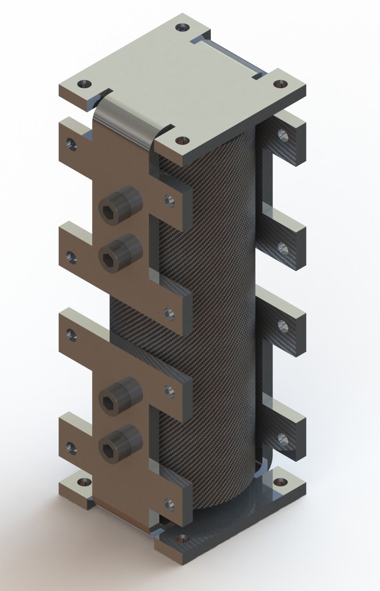
  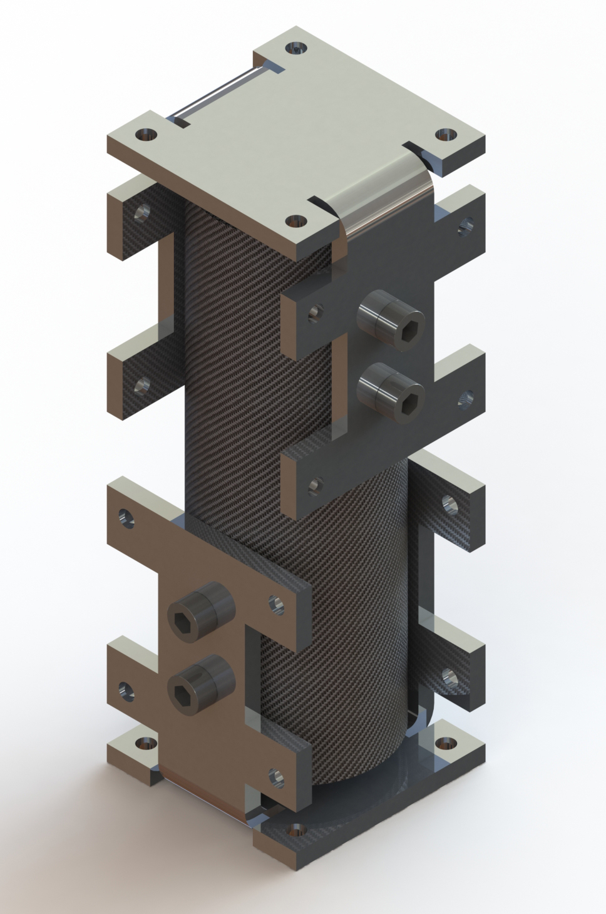
  <br>
  <em><strong>图 1 — v2 长连杆。</strong>X-X 与 X-Y 连杆采用 5 mm 5052 铝板、50 × 46 mm 碳管与 M5 连接节点。</em>
</p>

<p align="center">
  
  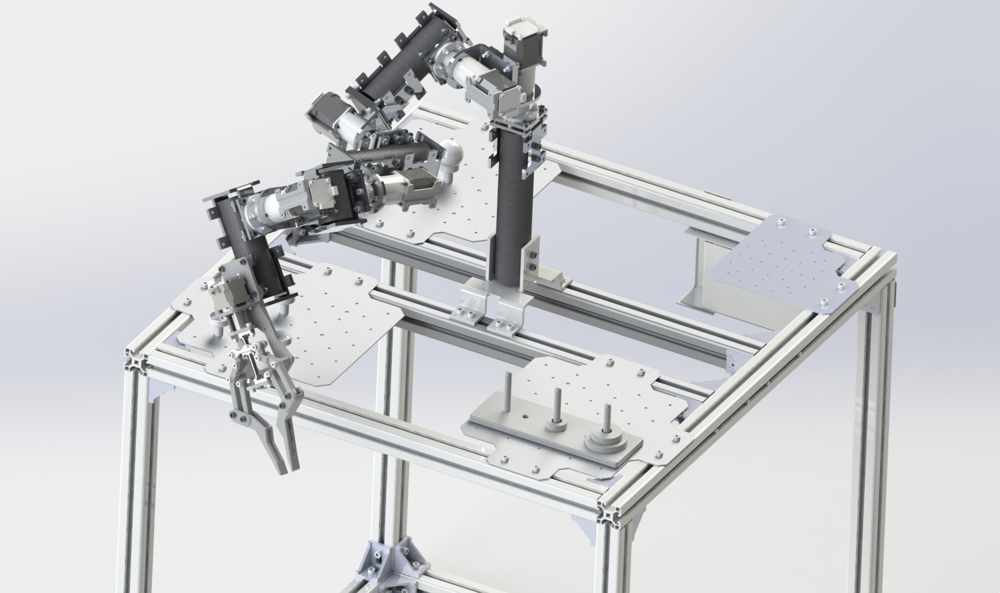
  <br>
  <em><strong>图 2 — v2 驱动模块与平台。</strong>42BYGH47 步进电机、FLE-42-20 减速器、CAN 板与 4040 铝型材工作平台。</em>
</p>

### v1 参考配置

| 子系统 | v1 实现 |
|---|---|
| 控制器 | Raspberry Pi Pico W，RP2040，Wi-Fi |
| 驱动 | 15 kgf·cm PWM 数字舵机 |
| 总线 | 16P 2.54 mm 金手指互连 |
| 板卡 | Base、Joint A、Joint B、Holder/Sensor、Expand Controller |
| 供电 | 5–9 V 舵机电源；5 V 逻辑电源 |

<p align="center">
  
  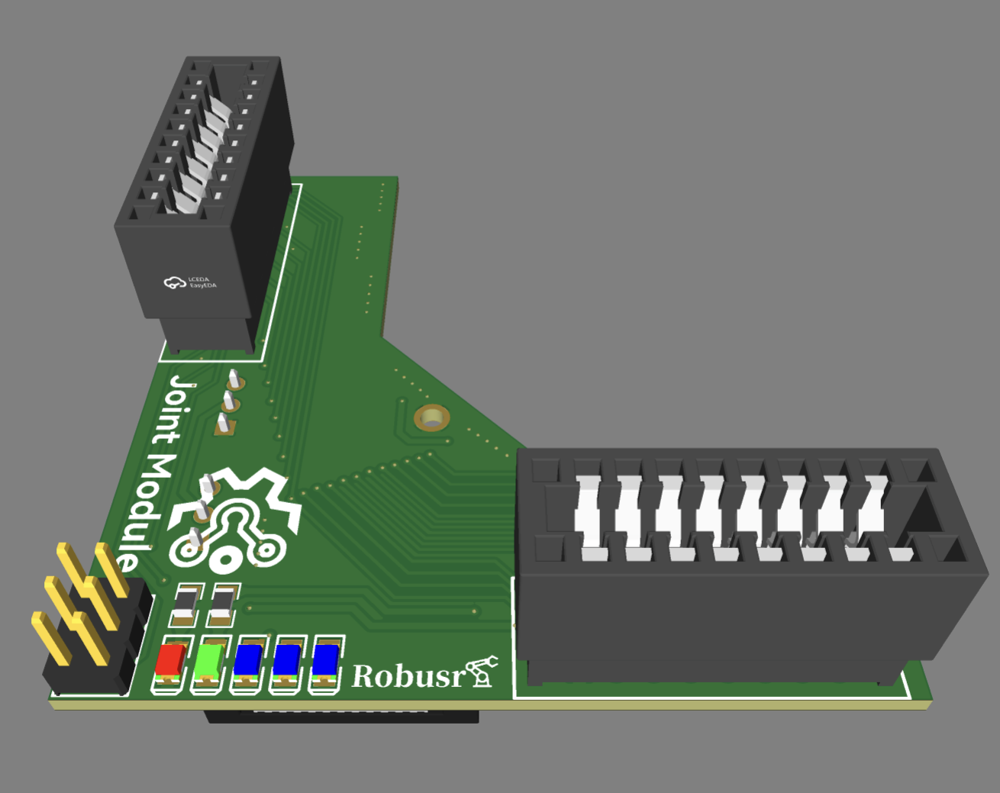
  <br>
  <em><strong>图 3 — v1 参考配置。</strong>舵机驱动机械臂渲染与 Joint Module PCB，包含 PWM 输出、状态 LED 与舵机信号选择。</em>
</p>

## 理论与设计

### 模块化组合

报告把串联链抽象为**连接面—连接通道—连接面**（FCF）。X-X 或 X-Y 长连杆为 6 个面 × 4 个通道；短连杆为 4 × 4；关节为 2 × 4。对三模块配置，1 个 45° 模块与 2 个 90° 模块可排列为 $3!$ 种；底座相邻方向固定，其余两个方向各有 2 种选择。结果为 24，并由 24 个 CAD 组合装配体与 3 个单关节模型核实。

<p align="center">
  
  
  <br>
  <em><strong>图 4 — FCF 抽象。</strong>每个连接由连接面、连接通道与另一个连接面组成。长连杆有 6 个面，短连杆 4 个，关节 2 个。</em>
</p>

### 运动学

分析构型为 **AyCxBy-D**，4 自由度。报告表 3-20 给出：

| $i$ | $d_i$ (mm) | $a_i$ (mm) | $\alpha_i$ | 报告范围 |
|---:|---:|---:|---:|---|
| 1 | 95 | 0 | 90° | 0° |
| 2 | 0 | 113.5 | 90° | 0–180° |
| 3 | 21.34 | 88.5 | 90° | 0–180° |
| 4 | 0 | 152 | 0° | 0–180° |

验证模型使用标准 DH：

$$
T_i = \operatorname{Rot}_z(\theta_i)\,\operatorname{Trans}_z(d_i)\,
\operatorname{Trans}_x(a_i)\,\operatorname{Rot}_x(\alpha_i).
$$

三段连杆长度之和为 $113.5 + 88.5 + 152 = 354$ mm。计入模型偏置后，采样工作空间最大可达距离约为 **450 mm**。

<p align="center">
  
  <br>
  <em><strong>图 5 — 工作空间对比。</strong>24 种布局中的四种：AyCxBy-D、AyCyBx-D、AyCxBx-D 与 AyCyBy-D。图中为运动学模型的仿真采样。</em>
</p>

装配选型在 24 种布局上比较工作空间包络与运动学代价指标。工作空间研究覆盖上图四种代表性布局。

### v2 有限元分析

v2 的 XY 长连杆按静力装配进行评估。底座连接固定，工作载荷施加在连接节点上。模型由 5 mm 5052 铝板与 50 × 46 mm 碳纤维管组成。

有限元方程为

$$
K u = f,
$$

其中 $K$ 为刚度矩阵，$u$ 为节点位移向量，$f$ 为节点载荷向量。同一载荷路径可用悬臂梁关系校核：

$$
M = F L, \qquad \sigma = \frac{M c}{I}, \qquad \delta = \frac{F L^3}{3 E I}.
$$

v2 分析给出位移幅值（URES）云图，最大值为

$$
u_{\max} = 1.388 \times 10^{-2}\ \text{mm}.
$$

<p align="center">
  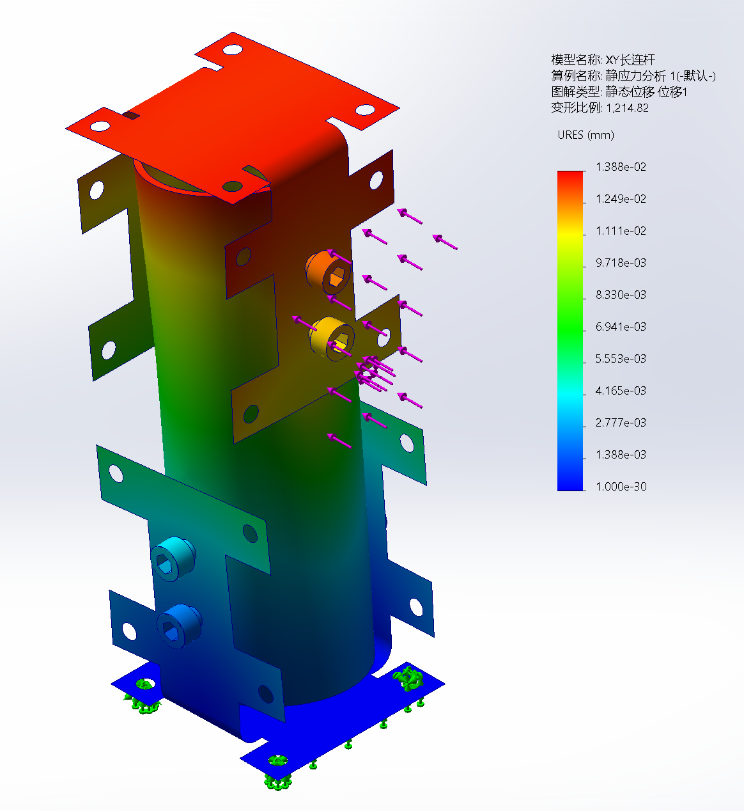
  <br>
  <em><strong>图 6 — v2 有限元分析。</strong>XY 长连杆静态位移云图。底座固定，连接节点承受工作载荷；URES 图例单位为毫米。</em>
</p>

### v2 数理分析推导

展板把每个连接抽象为连接面—连接通道—连接面（FCF）。各模块的连接方法数为：

- 底座：3 种。
- X-X 与 X-Y 长连杆：$2 \times 3 \times 3 = 18$ 种。
- 短连杆：$2 \times 2 \times 3 = 12$ 种。
- 关节：Pro 侧 $4 \times 1 \times 1 = 4$，Con 侧 $1 \times 4 \times 1 = 4$，每个关节模块合计 8 种。
- 通用末端连杆：$2 \times 2$ 或 $2 \times 3$ 种。

设关节模块数为 $F$、长连杆数为 $N_{LL}$、短连杆数为 $N_{LS}$，FCF 连接方法总数为

$$
N_{com} = \sum_{i=0}^{N_{LL}} \sum_{j=0}^{N_{LS}} 8^F \cdot 18^{N_{LL}} \cdot 12^{N_{LS}}.
$$

<p align="center">
  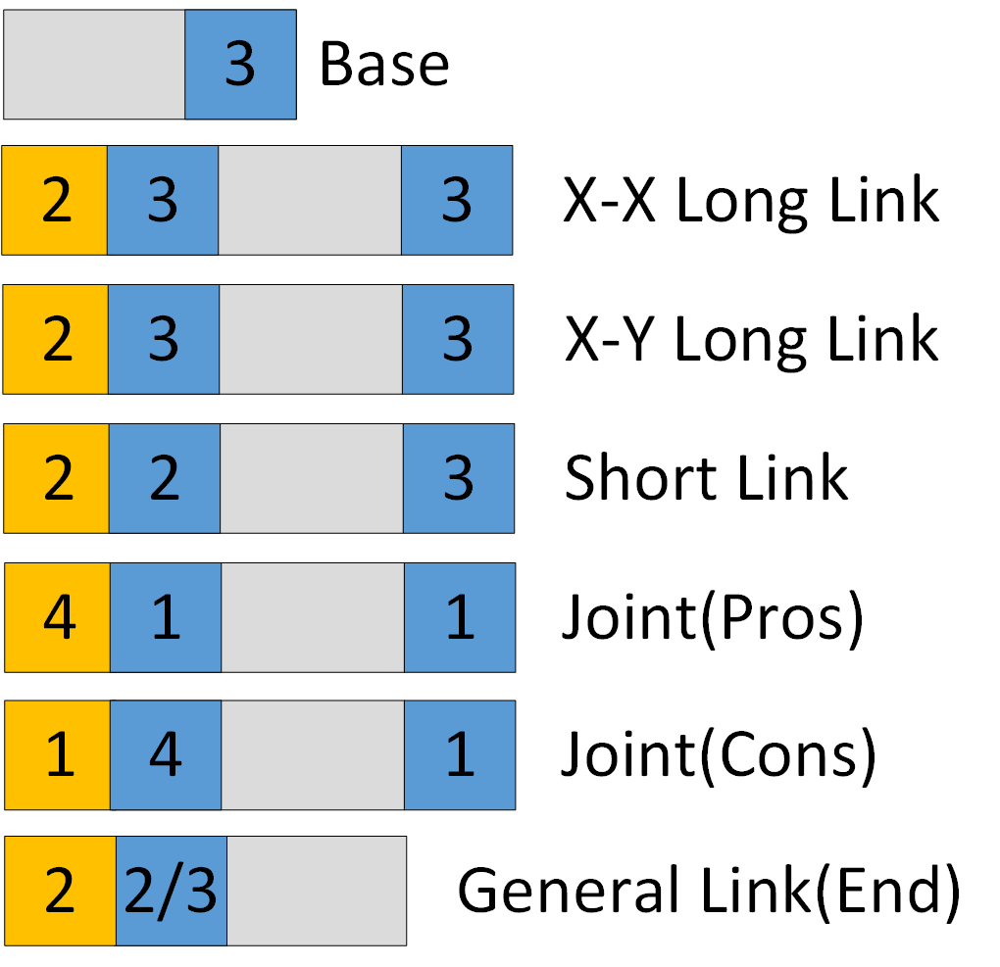
  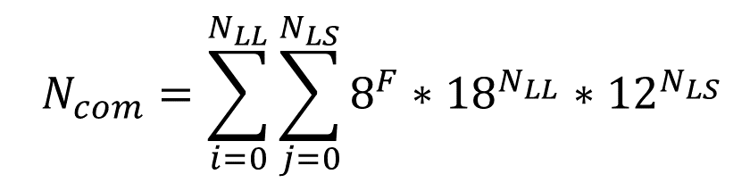
  <br>
  <em><strong>图 7 — FCF 连接方法总数。</strong>各模块连接方法数与 v2 展板使用的总数公式。</em>
</p>

对三模块装配，底座相邻方向固定，其余两个模块各有两种垂直通道：

$$
N_3 = 3! \cdot 2^{3-1} = 24.
$$

正运动学采用标准 DH 变换：

$$
T_i^{i-1} =
\begin{bmatrix}
c\theta_i & -s\theta_i c\alpha_i & s\theta_i s\alpha_i & a_i c\theta_i \\
s\theta_i & c\theta_i c\alpha_i & -c\theta_i s\alpha_i & a_i s\theta_i \\
0 & s\alpha_i & c\alpha_i & d_i \\
0 & 0 & 0 & 1
\end{bmatrix},
\qquad
T_4^0 = T_1^0 T_2^1 T_3^2 T_4^3.
$$

工作空间为关节范围内的末端位置集合：

$$
\mathcal{W} = \left\{ \mathbf{p}(q) \mid q_i \in [q_{i,\min}, q_{i,\max}] \right\},
\qquad
\mathbf{p}(q) = [T_4^0(q)]_{1:3,4}.
$$

采样包络最大可达距离约为 450 mm。装配选型使用展板的运动学代价指标

$$
E_{Sum} = \sum_{i=1}^{F} \left| \int_0^t \dot{\theta}_i(\tau)\,d\tau \right|,
$$

并结合工作空间包络。流程如下图所示。

<p align="center">
  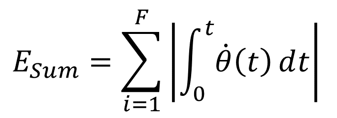
  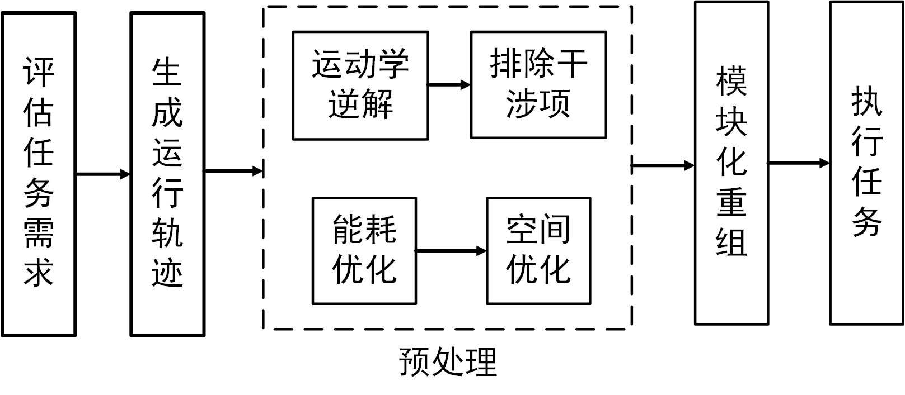
  <br>
  <em><strong>图 8 — v2 装配选型流程。</strong>代价指标与工作空间预处理路径。</em>
</p>

### v1 参考静态分析

v1 静态分析采用 9400A 光敏树脂，在每个关节顶面施加 10 N 载荷。关节外壳与整机装配均在 SolidWorks Simulation 中评估。

<p align="center">
  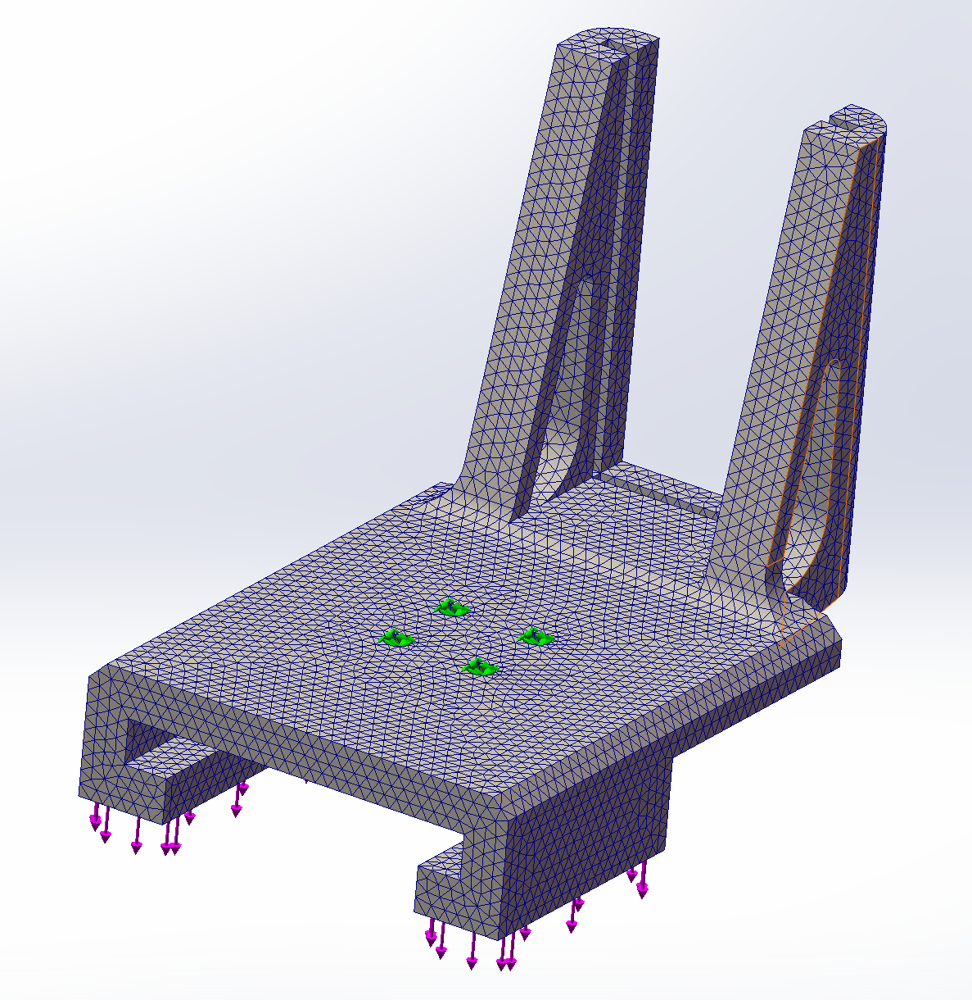
  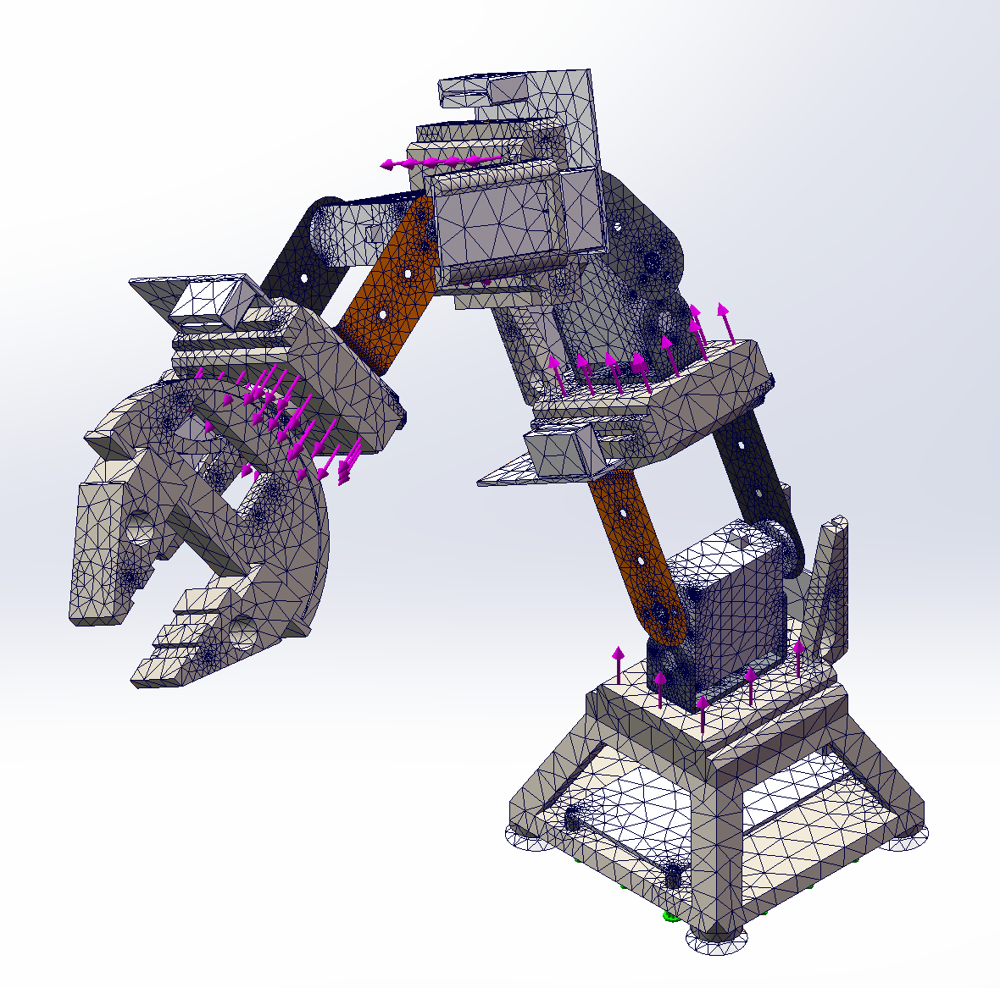
  <br>
  <em><strong>图 9 — v1 参考静态分析。</strong>10 N 载荷工况下关节外壳的网格与应力结果。</em>
</p>

## 仓库结构

```text
OnesArm/
├── BOM/                    汇总与制造清单
├── electronics/            Gerber、BOM 与丝印输出
├── mechanical/
│   ├── source/             SolidWorks 零件与装配
│   ├── output/             STEP、STL 与制造导出
│   └── analysis/fea/       有限元结果图片
├── firmware/               STM32CubeIDE 工程 + MicroPython 库
├── software/               MATLAB 运动学脚本
├── docs/
│   ├── en/ zh-CN/ fr/      三语长文档
│   ├── report/             2025 版报告与答辩 PPT
│   ├── archive/            2024 版报告与研究日志
│   └── references/         文献与来源
├── media/
│   ├── photos/project/     v2 渲染、v1 配置照片、PCB 与测试视图
│   ├── photos/reference/   报告插图与关键图
│   ├── gifs/               v1 参考配置演示
│   ├── videos/             原始 MP4
│   └── source/             可编辑展板源文件
├── data/                   数据与日志目录
├── scripts/verify_theory/  纯 Python 运动学与尺寸检查
├── README.md README.zh-CN.md README.fr.md
├── MIGRATION_NOTES.md CHANGELOG.md CONTRIBUTING.md
├── LICENSE.md LICENSE-docs.md
├── .gitignore .gitattributes
└── .github/
```

## 物料清单

摘要见 [`BOM/onesarm_bom.md`](BOM/onesarm_bom.md)，机器可读版本见 [`BOM/onesarm_bom.csv`](BOM/onesarm_bom.csv)。原始清单在 [`BOM/manufacturing/`](BOM/manufacturing/)。

### v2 当前平台

| 类别 | v2 项目 | 数量 |
|---|---|---|
| 长连杆 | X-X 与 X-Y，5 mm 5052 铝 + 碳管 | 4 + 4 |
| 短连杆 | 5 mm 5052 铝 | 4 |
| 关节 | 45° × 1，90° × 2 | 3 |
| 驱动 | 42BYGH47 + FLE-42-20，1:20 | 3 套 |
| 控制 | STM32F103C8T6 CAN 模块 + STM32F407ZGT6 控制器 | 1 套 |
| 电源 | 350 W 直流电源，XT60 | 1 |
| 平台 | 4040 铝型材，三块测试板 | 1 |
| 末端执行器 | 夹爪、超声波、气体传感器、手写笔 | 4 个模块 |

### v1 参考配置

| 类别 | v1 项目 | 数量 |
|---|---|---|
| 驱动 | 15 kgf·cm PWM 舵机 | 3 |
| 控制器 | Raspberry Pi Pico W | 1 |
| 模块板 | Base、Joint A/B、Holder/Sensor、Expand Controller | 5 |
| 互连 | 16P 2.54 mm 金手指 | 按需 |
| 打印关节 | 9400A 树脂关节外壳 | 3 + 3 |

## 快速开始

### v2 装配

1. **制造结构件。** 使用 `mechanical/output/` 中的 STEP/STL，切割折弯 5 mm 5052 连杆，粘接 50 × 46 mm 碳管，打印 9400A 关节外壳。
2. **制造电子。** 按 `electronics/output/gerber/controller_monitor/` 中的 Gerber 下单，并按 `electronics/output/bom/controller_monitor/` 备料。
3. **装配平台。** 搭建 4040 框架，安装 350 W 电源，固定 Controller 与 Monitor 板。
4. **配置控制。** 用 STM32CubeIDE 打开 `firmware/stm32/` 中的工程，按选定构型配置 CAN 总线与关节模块。
5. **运行分析。** 使用 `software/matlab/kinematics/` 中的 MATLAB 脚本，以及 `scripts/verify_theory/` 中的独立 Python 检查。

```bash
python scripts/verify_theory/report_checks.py
python -m unittest discover -s scripts/verify_theory -v
```

### v1 参考装配

1. 打印 v1 关节外壳，装配五块 v1 模块板。
2. 按 `electronics/output/gerber/v1_module_boards/` 中的 Gerber 下单，制作 16P 金手指线束。
3. 用 `firmware/micropython/` 中的 MicroPython 库烧录 Pico W，并连接舵机电源。

## 演示与测试

v2 的 CAD 与平台视图展示当前结构与驱动组件。

<p align="center">
  
  <br>
  <em><strong>图 10 — v2 工作平台。</strong>步进驱动机械臂、铝/碳连杆与 4040 框架。</em>
</p>

v1 参考配置演示展示舵机/Pico 机械臂运动、扩展控制器 OLED/GNSS 显示、夹爪/手写模块与仿真界面。

<p align="center">
  
  
</p>

<p align="center">
  
  
</p>

<p align="center">
  
  
  
  <br>
  <em><strong>图 11 — v1 参考配置与装配视图。</strong>舵机/Pico 配置、模块堆叠与 24 种排列/方向组合。</em>
</p>

## 设计参数

### v2 当前平台

| 参数 | 数值 | 来源 |
|---|---|---|
| 分析构型 | AyCxBy-D，4 自由度 | 报告 §3.3 |
| 连杆参数 $d_1, a_2, d_3, a_3, a_4$ | 95、113.5、21.34、88.5、152 mm | 报告表 3-20 |
| 连杆长度和 | 354 mm | 计算 |
| 模型最大可达距离 | 约 450 mm | 计算，10,000 次采样 |
| 装配数 | 24 种组合 | $3!\,2^{2}$；24 个 CAD 文件 |
| 驱动 | 42BYGH47 + FLE-42-20，1:20 | 报告 §5.2.2 |
| 控制器 | STM32F103C8T6 CAN + STM32F407ZGT6 | 报告 §5.2.2 / §5.2.3 |
| 平台 | 4040 铝型材，350 W 电源 | 报告 §5.2.3 |
| 结构 | 5 mm 5052 铝板 + 50 × 46 mm 碳管 | 报告 §5.2.1 |
| 有限元材料 | 9400A 树脂，$E=2.75$ GPa，$\nu=0.44$，1150 kg/m³ | 报告表 3-1 |
| 有限元载荷 | 每个关节顶面 10 N | 报告 §3.1.2 |

### v1 参考配置

| 参数 | 数值 | 来源 |
|---|---|---|
| 驱动 | 15 kgf·cm PWM 舵机，5–9 V，180° | 报告 §2.3.1 |
| 控制器 | Raspberry Pi Pico W，RP2040 | 报告 §2.3.2 |
| 模块板 | Base、Joint A/B、Holder/Sensor、Expand Controller | 报告 §2.3.2 |
| 互连 | 16P 2.54 mm 金手指 | 报告 §2.3.2 |
| 逻辑供电 | 5 V | 报告 §2.3.2 |

## 技术文档

- [工作原理](docs/zh-CN/theory_of_operation.md)
- [机械设计](docs/zh-CN/mechanical_design.md)
- [电子与控制](docs/zh-CN/electronics_and_control.md)
- [装配与复现](docs/zh-CN/assembly_and_replication.md)
- [验证](docs/verification.md)
- [术语表](docs/glossary.md)

英文与法文版本见 [`docs/en/`](docs/en/) 与 [`docs/fr/`](docs/fr/)。

## 贡献

见 [`CONTRIBUTING.md`](CONTRIBUTING.md)。第三方图片请附来源与许可说明。

## 许可证

- **代码、固件与脚本：** [MIT](LICENSE.md)。
- **文档、原始 CAD、照片与图：** [CC BY 4.0](LICENSE-docs.md)。
- **第三方图片、论文、视频与商标：** 不在上述许可范围内，见 [`docs/references/README.md`](docs/references/README.md)。

## 致谢

- **作者：** 郭沫晗，宁夏固原市第一中学。
- **老师与指导：** 马博伟（学校机器人创新工作室）、杨旭（电子科技大学）、邵金龙（宁夏大学），详见报告致谢。
- **赛事：** 第 38 届全国青少年科技创新大赛（2024）。
- **参考文献：** 连续型机器人、模块化机械臂、榫卯节点与蛇形机器人文献，见 [`docs/references/README.md`](docs/references/README.md)。
- **工具：** SolidWorks、MATLAB Robotics Toolbox、EasyEDA/LCEDA、STM32CubeIDE、MicroPython、ffmpeg 与 Pillow。
