<p align="center">
  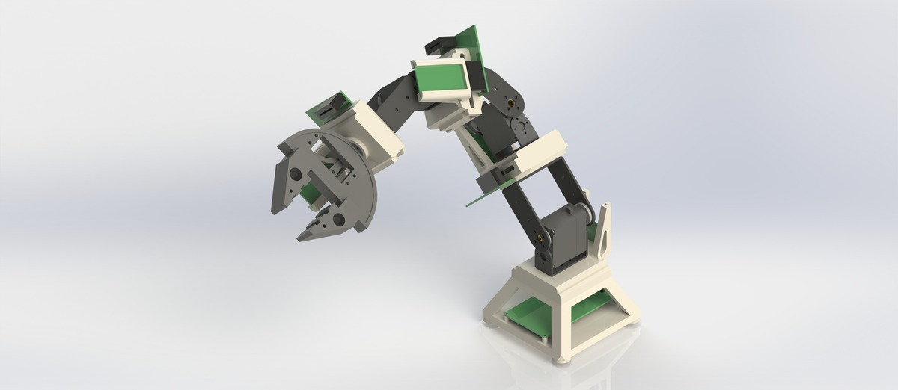
</p>

<h1 align="center">OnesArm（珠联“臂”合）</h1>

<p align="center">
  <strong>面向多场景的可重构模块化串联机械臂</strong>
  <br>
  24 种关节布局、榫卯式接口、两代有文档的硬件方案
</p>

<p align="center">
  <a href="./LICENSE.md"></a>
  <a href="./LICENSE-docs.md"></a>
  
  
  
</p>

<p align="center">
  <a href="./README.md">English</a> |
  <a href="./README.zh-CN.md">中文</a> |
  <a href="./README.fr.md">Français</a>
</p>

---

## 关于项目

**OnesArm**（项目名“珠联‘臂’合”）是一台由可互换的关节、连杆与末端执行器模块组成的模块化串联机械臂。它没有固定的一条运动链，而是通过标准化的 **T/N 榫卯接口** 组装。对三模块样机，与底座相邻的模块方向固定，其余两个模块各有两种互相垂直的连接通道，因此得到

$$
N_3 = 3! \cdot 2^{3-1} = 24
$$

种关节布局。24 种装配均已建成 SolidWorks 模型。

项目由宁夏固原市第一中学郭沫晗完成。报告记载获得第 38 届全国青少年科技创新大赛一等奖（2024）。仓库把**有文档的**、**可复算的**与**尚未实测的**内容分开标注。

> **仓库记录了两代硬件。** v1 使用 15 kgf·cm PWM 舵机与 Raspberry Pi Pico W；v2 使用 42BYGH47 步进电机、FLE-42-20 减速器与 STM32 CAN 平台。两者引脚不兼容。下单前请先读 [`docs/errata.md`](docs/errata.md)。

## 关键特性

- **24 种可重构关节布局** — 三个可互换模块，每个模块两个垂直通道，底座相邻方向固定。
- **榫卯式 T/N 接口** — 顶部 T 节点、底部 N 节点，M5 螺丝夹紧；灵感来自燕尾榫与十字刻半榫。
- **两代有文档的驱动方案** — 低成本舵机/Pico W 样机，以及带 350 W 电源的步进/CAN 平台。
- **多场景末端执行器** — 平行夹爪、HC-SR04 超声波、MQ 气体传感器与手写笔模块共用接口。
- **开放的制造包** — SolidWorks 源文件、STEP/STL、Gerber、BOM 与制造清单。
- **可复现的审查** — 针对 DH 变换、关节范围、工作空间与载荷工况的勘误和纯 Python 复算。

## 系统架构

```text
                    ┌──────────────────────────────┐
                    │  末端执行器                   │
                    │  夹爪 / 超声波 / 气体传感器    │
                    └──────────────┬───────────────┘
                                   │ T/N 接口
                    ┌──────────────┴───────────────┐
                    │  连杆模块（XX / XY / 短连杆）  │
                    └──────────────┬───────────────┘
                                   │
                    ┌──────────────┴───────────────┐
                    │  关节模块（45° / 90°）         │
                    │  驱动 + 轴承 + PCB             │
                    └──────────────┬───────────────┘
                                   │
                    ┌──────────────┴───────────────┐
                    │  底座 + 工作平台 + 电源         │
                    └──────────────────────────────┘
```

| 版本 | 控制器 | 驱动 | 模块总线 | 供电 |
|---|---|---|---|---|
| **v1** | Raspberry Pi Pico W（RP2040，Wi-Fi） | 15 kgf·cm PWM 舵机 | 16P 2.54 mm 金手指 | 5–9 V 舵机电源 |
| **v2** | STM32F103C8T6 CAN 模块 + STM32F407ZGT6 控制器 | 42BYGH47 + FLE-42-20（1:20） | CAN（TJA1050） | 350 W 直流，XT60 |

<p align="center">
  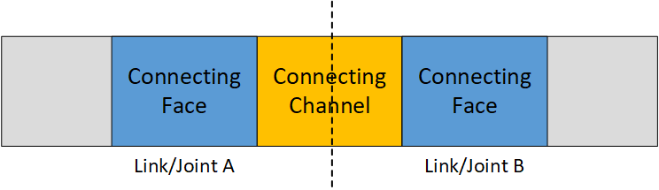
  
  <br>
  <em><strong>图 1 — FCF 抽象。</strong>每个连接由连接面、连接通道与另一个连接面组成。长连杆有 6 个面，短连杆 4 个，关节 2 个。</em>
</p>

<p align="center">
  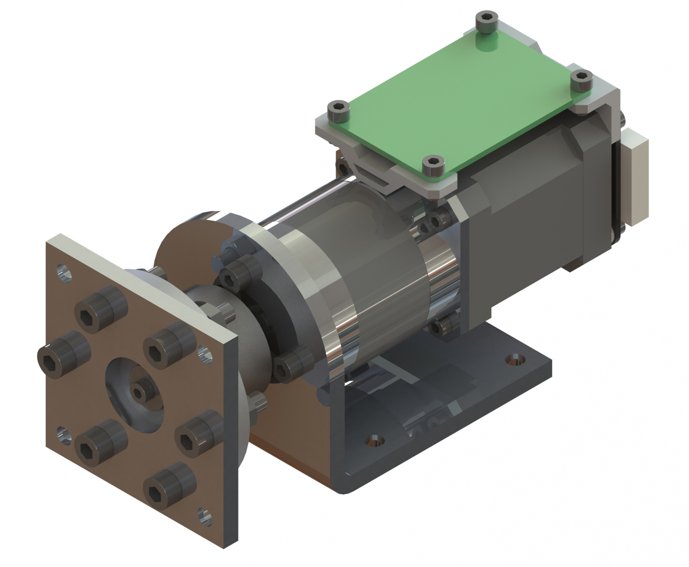
  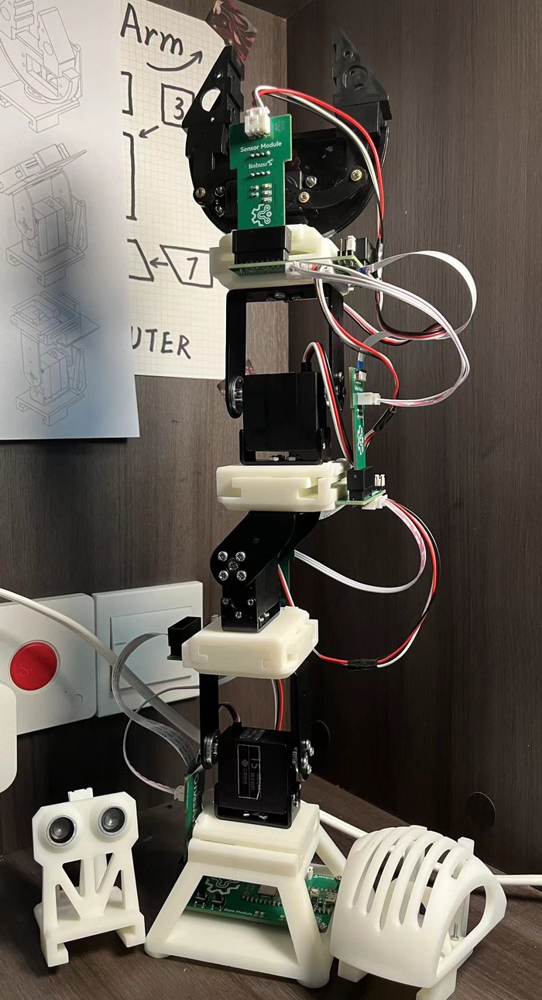
  <br>
  <em><strong>图 2 — 驱动模块与样机。</strong>2024 样机使用打印关节外壳、钣金连杆与四吸盘底座；v2 渲染展示步进/减速器组件。</em>
</p>

## 理论与设计

### 模块化组合

报告把串联链抽象为**连接面—连接通道—连接面**（FCF）。X-X 或 X-Y 长连杆为 6 个面 × 4 个通道；短连杆为 4 × 4；关节为 2 × 4。对三模块样机，1 个 45° 模块与 2 个 90° 模块可排列为 $3!$ 种；底座相邻方向固定，其余两个方向各有 2 种选择。结果为 24，并由 24 个 CAD 组合装配体与 3 个单关节模型核实。

### 运动学

分析构型为 **AyCxBy-D**，4 自由度。报告表 3-20 给出：

| $i$ | $d_i$ (mm) | $a_i$ (mm) | $\alpha_i$ | 报告范围 |
|---:|---:|---:|---:|---|
| 1 | 95 | 0 | 90° | 0° |
| 2 | 0 | 113.5 | 90° | 0–180° |
| 3 | 21.34 | 88.5 | 90° | 0–180° |
| 4 | 0 | 152 | 0° | 0–180° |

标准 DH 为

$$
T_i = \operatorname{Rot}_z(\theta_i)\,\operatorname{Trans}_z(d_i)\,
\operatorname{Trans}_x(a_i)\,\operatorname{Rot}_x(\alpha_i).
$$

报告印刷的是另一种顺序 $\operatorname{Rot}_z\operatorname{Rot}_x\operatorname{Trans}(a,0,0)\operatorname{Trans}(0,0,d)$，且式 (3.7) 的第三列为零。两种约定给出的末端位置不同。仓库在复算中使用标准 DH，并在 [`docs/errata.md`](docs/errata.md) 中记录差异。

<p align="center">
  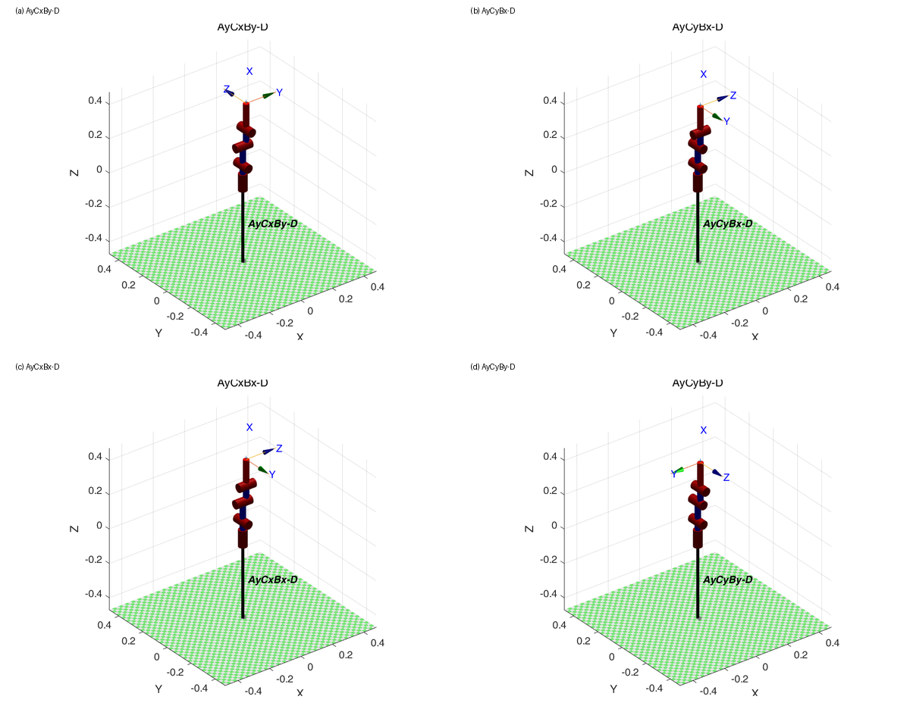
  <br>
  <em><strong>图 3 — 工作空间对比。</strong>24 种布局中的四种：AyCxBy-D、AyCyBx-D、AyCxBx-D、AyCyBy-D。图中是仿真采样点，不是实测；由模型随机采样得到的最大可达距离约 0.45 m。</em>
</p>

报告中的“能耗”指标是关节加速度（展板文字为一阶速度）的积分，不是电能。本仓库把它称为**运动学代价指标**，并在文档中明确说明。

## 仓库结构

```text
OnesArm/
├── BOM/                    汇总与原始制造清单
├── electronics/            Gerber、BOM、丝印输出；无 EDA 源
├── mechanical/
│   ├── source/             SolidWorks 零件与装配
│   ├── output/             STEP、STL 与制造导出
│   └── analysis/fea/       有限元结果图片
├── firmware/               STM32 CubeMX 工程 + MicroPython 库
├── software/               MATLAB 运动学脚本
├── docs/
│   ├── en/ zh-CN/ fr/      三语长文档
│   ├── errata.md           理论与证据审查
│   ├── verification.md     数值复算与测试结果
│   ├── report/             2025 版报告与答辩 PPT
│   └── archive/            2024 版报告、研究日志、相关概念
├── media/
│   ├── photos/project/     渲染、样机、PCB 与测试照片
│   ├── photos/reference/   报告插图与关键图
│   ├── gifs/               4 个演示 GIF
│   ├── videos/             原始 MP4（Git 忽略）
│   └── source/             可编辑展板源文件（Git 忽略）
├── data/                   无实测数据（已说明）
├── scripts/verify_theory/  纯 Python 复算与测试
├── README.md README.zh-CN.md README.fr.md
├── MIGRATION_NOTES.md CHANGELOG.md CONTRIBUTING.md
├── LICENSE.md LICENSE-docs.md
├── .gitignore .gitattributes
└── .github/
```

## 物料清单

摘要见 [`BOM/onesarm_bom.md`](BOM/onesarm_bom.md)，机器可读版本见 [`BOM/onesarm_bom.csv`](BOM/onesarm_bom.csv)。原始清单在 [`BOM/manufacturing/`](BOM/manufacturing/)。

| 类别 | 主要项目 | 数量 |
|---|---|---|
| 长连杆 | X-X 与 X-Y，5 mm 5052 铝 + 碳管 | 4 + 4 |
| 短连杆 | 5 mm 5052 铝 | 4 |
| 关节 | 45° × 1，90° × 2 | 3 |
| v1 驱动 | 15 kgf·cm PWM 舵机 | 3 |
| v2 驱动 | 42BYGH47 + FLE-42-20（1:20） | 3 套 |
| 控制 | Pico W（v1）或 STM32 CAN 平台（v2） | 1 套 |
| 平台 | 4040 铝型材、350 W 电源 | 1 |
| 末端 | 夹爪、超声波、气体传感器、手写笔 | 4 个模块 |

归档没有整机质量、负载或实测功率。

## 快速开始

1. **选版本。** v1（舵机/Pico W）或 v2（步进/CAN）。不要混用板卡。
2. **做机械。** 打印关节外壳、切割/折弯连杆、粘接碳管，按 [`docs/zh-CN/assembly_and_replication.md`](docs/zh-CN/assembly_and_replication.md) 装配。
3. **做电子。** 按 Gerber 下单并焊 BOM。没有 EDA 源，装配前对照板卡照片。
4. **跑分析。** MATLAB 脚本在 `software/matlab/kinematics/`；独立 Python 复算在 `scripts/verify_theory/`。
5. **逐关节上电。** 归档固件是骨架，需要按版本补 PWM 或 CAN 应用。

```bash
# 独立复算（不需要 MATLAB）
python scripts/verify_theory/report_checks.py
python -m unittest discover -s scripts/verify_theory -v
```

## 演示与测试

以下 GIF 是**台架演示**，不是受控实验。它们展示整臂运动、扩展控制器 OLED/GNSS 显示、夹爪/手写模块与仿真界面。仓库不声称已测得负载或重复定位精度。

<p align="center">
  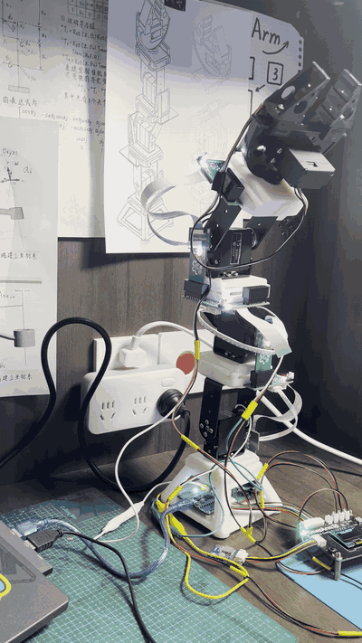
  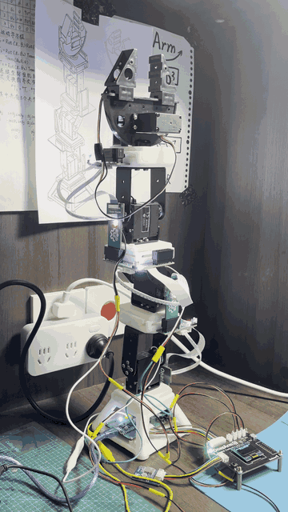
</p>

<p align="center">
  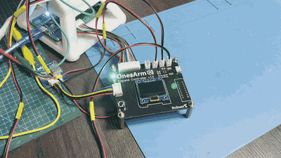
  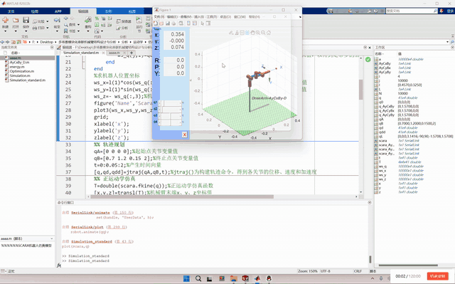
</p>

<p align="center">
  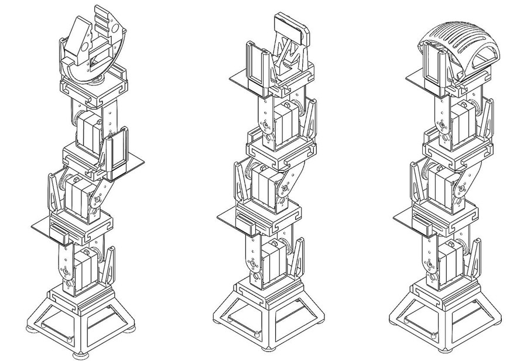
  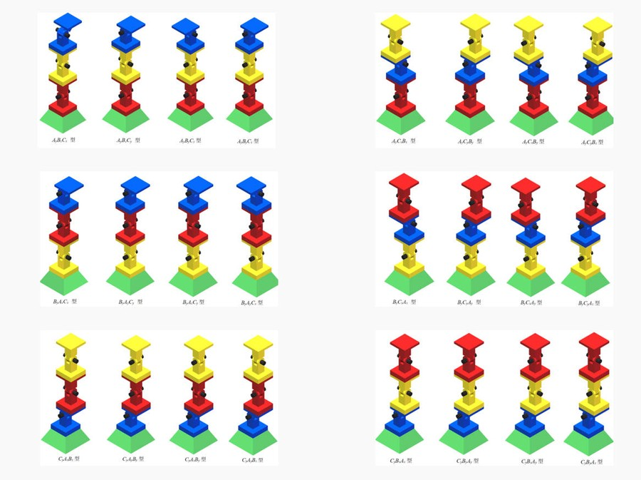
  <br>
  <em><strong>图 4 — 装配视图。</strong>左：模块堆叠；右：装配研究使用的 24 种排列/方向组合。</em>
</p>

## 设计参数

| 参数 | 数值 | 来源 |
|---|---|---|
| 分析构型 | AyCxBy-D，4 自由度 | 报告 §3.3 |
| 连杆参数 $d_1, a_2, d_3, a_3, a_4$ | 95、113.5、21.34、88.5、152 mm | 报告表 3-20 |
| 连杆长度和 | 354 mm | 计算 |
| 模型最大可达距离 | 约 450 mm | 计算，10,000 次采样 |
| 报告关节范围 | q1 0°，q2–q4 0–180° | 报告表 3-20 |
| MATLAB 关节范围 | q1 0°，q2 0–180°，q3/q4 ±90° | `software/matlab/kinematics`（冲突） |
| 装配数 | 24 种组合 | $3!\,2^{2}$；24 个 CAD 文件 |
| 有限元材料 | 9400A 树脂，$E=2.75$ GPa，$\nu=0.44$，1150 kg/m³ | 报告表 3-1 |
| 有限元载荷 | 每个关节顶面 10 N | 报告 §3.1.2 |
| v1 舵机 | 15 kgf·cm（1.47 N·m）堵转，6 V 时 0.16 s/60° | 报告 §2.3.1 |
| v2 驱动 | 42BYGH47 + FLE-42-20，1:20 | 报告 §5.2.2 |
| 控制器 | Pico W（v1）/ STM32F103 + STM32F407 CAN（v2） | 报告 §2.3.2 / §5.2.2 |
| 平台 | 4040 铝型材、350 W 电源 | 报告 §5.2.3 |
| 实测负载、质量、重复精度、功率 | **暂无** | 归档没有测量日志 |

## 勘误与已知问题

- 报告式 (3.7) 的旋转块奇异（第三列为零）。
- 报告使用非标准 DH 顺序，MATLAB 使用标准 DH，两者末端位置不同。
- 表 3-20 与 MATLAB 的第 3/4 关节范围不同。
- 印刷的一般组合公式 (3.11) 不能得到 24；式 (3.1) 与 CAD 可以。
- “能耗”指标是运动学代价；`Optimization.m` 是 MediaPipe 姿态可视化，不是该优化。
- 10 N 作用在 0.354–0.450 m 处为 3.54–4.50 N·m，超过单舵机 1.47 N·m 堵转扭矩。
- STM32 工程是骨架；没有机械臂固件，也没有 MicroPython `main.py`。
- 没有 EDA 源，没有实测数据。

详见 [`docs/errata.md`](docs/errata.md) 与 [`docs/verification.md`](docs/verification.md)。

## 路线图

1. 冻结硬件版本，解决 42BYGH27/47 冲突。
2. 统一 DH 约定，重画图表，并对 24 种装配实现逆运动学与代价指标。
3. 补一条最小 PWM/CAN 固件路径，并记录一组关节跟踪数据。
4. 找回 EDA 源，发布可制造板卡版本。
5. 在规定力臂下测量负载、重复精度、质量与输入功率。

## 贡献

见 [`CONTRIBUTING.md`](CONTRIBUTING.md)。不要加入未经测量的数字；第三方图片必须附来源与许可说明。

## 许可证

- **代码、固件与脚本：** [MIT](LICENSE.md)。
- **文档、原始 CAD、照片与图：** [CC BY 4.0](LICENSE-docs.md)。
- **第三方图片、论文、视频与商标：** 不在上述许可范围内，见 [`docs/references/README.md`](docs/references/README.md)。

公开发布前，作者应确认许可证选择。

## 致谢

- **作者：** 郭沫晗，宁夏固原市第一中学。
- **老师与指导：** 马博伟（学校机器人创新工作室）、杨旭（电子科技大学）、邵金龙（宁夏大学），详见报告致谢。
- **赛事：** 第 38 届全国青少年科技创新大赛（2024）。
- **参考文献：** 连续型机器人、模块化机械臂、榫卯节点与蛇形机器人文献，见 [`docs/references/README.md`](docs/references/README.md)。
- **工具：** SolidWorks、MATLAB Robotics Toolbox、EasyEDA/LCEDA、STM32CubeIDE、MicroPython、ffmpeg 与 Pillow。
