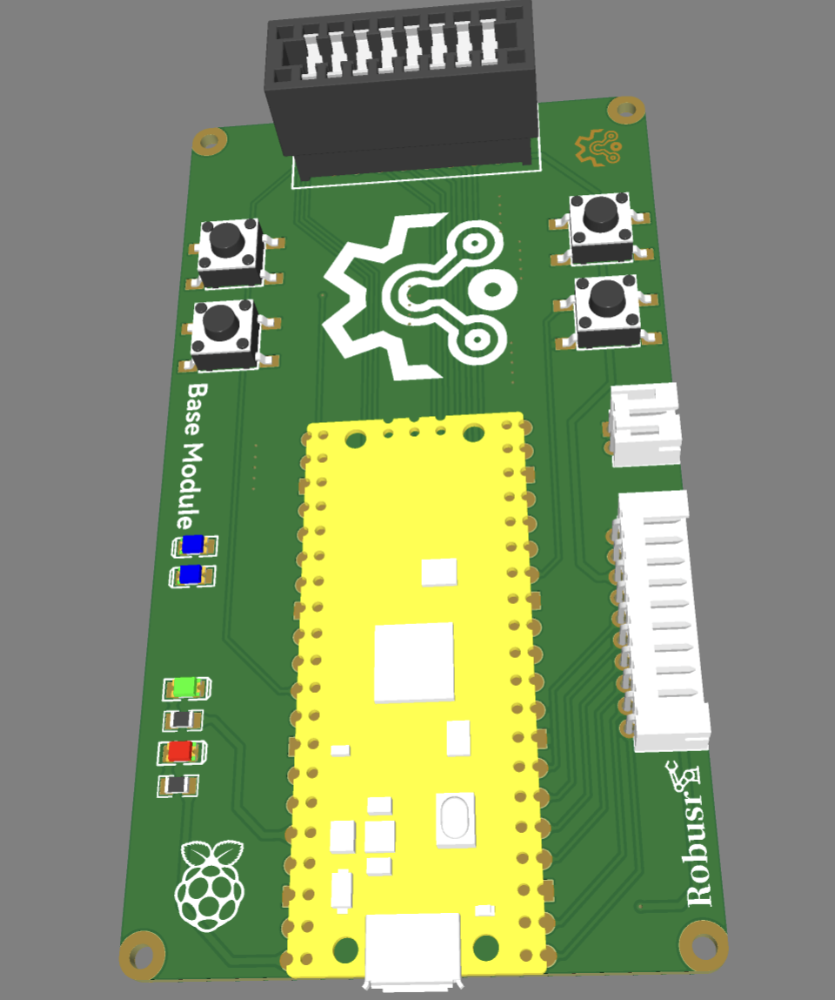

# Electronics and Control

## 1. Two revisions

OnesArm has two documented electronic platforms. They are not pin-compatible.

| Item | v1 (2024, report Ch. 2–4) | v2 (2024-07 onward, report Ch. 5) |
|---|---|---|
| Controller | Raspberry Pi Pico W (RP2040, 133 MHz, Wi-Fi) | STM32F103C8T6 CAN modules + STM32F407ZGT6 controller |
| Drive | 15 kgf·cm PWM servo | 42BYGH47 stepper + FLE-42-20 (1:20) |
| Feedback | Servo internal | Magnetic encoder, closed-loop controller |
| Inter-module bus | 16P 2.54 mm gold-finger | CAN (TJA1050 transceivers) |
| Module power | 5–9 V servo rail | 350 W DC supply, XT60 |
| Boards | Base, Joint A, Joint B, Holder/Sensor, Expand Controller | OnesArm Controller, OnesArm Monitor |

## 2. v1 architecture

The Pico W base board exposes SPI and I2C expansion and a separate supply input. Joint A/B boards each provide three PWM outputs, five status LEDs and a three-way servo signal selector set by jumpers. The Holder/Sensor board provides two ADC inputs and three PWM outputs. The Expand Controller adds a GNSS module, a 0.96-inch monochrome OLED, an 8 × 2P gold-finger header for module debugging and a USB Type-B power input.

Intra-module wiring uses 12P 1 mm FPC and XH 3P 2.54 mm leads; modules connect through 16P 2.54 mm gold-finger plugs and sockets. The connector choice is compact but not keyed for reverse insertion; mark pin 1 on every cable.

## 3. v2 architecture

The Controller and Monitor boards use a TJA1050 CAN transceiver, an LM2596-5.0 buck regulator, XT60 power connectors, 2 × 20 and 2 × 29 headers, four buttons and status LEDs. The BOM does not list an MCU chip because the STM32 modules plug into the headers. The 350 W supply feeds the stepper drivers and the bus controller.

The CAN bit rate, node IDs, termination and message layout are **not documented** in the archive. Define them before connecting multiple joint modules.

## 4. Power

- v1: servo rail 5–9 V; the Pico W needs a regulated 5 V supply. The Expand Controller accepts an external USB Type-B supply.
- v2: 350 W DC supply through XT60; LM2596 provides 5 V logic. Check the input range of every stepper driver before applying power.
- Add a fuse, reverse-polarity protection and an emergency stop. The archive does not show them on the boards.

## 5. Firmware status

| Project | State |
|---|---|
| `firmware/stm32/demo_LED` | CubeMX skeleton; empty user loop |
| `firmware/stm32/demo_LED1` | CubeMX skeleton |
| `firmware/stm32/demo_test` | GPIO + RTC skeleton |
| `firmware/stm32/Key` | Key driver has compile errors; header is empty |
| `firmware/stm32/KeyLED` | Empty user code |
| `firmware/stm32/彩色液晶屏驱动...` | LCD driver project; verify wiring |

CAN is commented out in every HAL configuration. There is no servo PWM, stepper pulse or CAN application code. The projects are useful as clock/pin references, not as a controller.

MicroPython contains only an SSD1306 OLED driver and L76X/micropyGPS GNSS libraries. There is no `main.py` and no arm kinematics. The report’s claim of a MicroPython open-loop test is not supported by the archived code. See [errata E-11](../errata.md).

## 6. Bring-up order

1. Inspect the board for solder bridges and polarity; do not fit the MCU module yet.
2. Apply 5 V from a current-limited supply; check the 3.3 V rail and current draw.
3. Fit the MCU module and flash a blink/LED test from the matching CubeMX project.
4. Check one servo or stepper channel on the bench, without the arm attached.
5. Connect one joint module, verify the CAN bus or PWM signal, then add the next module.
6. Only then assemble the arm and run a slow, low-amplitude trajectory.

## 7. Missing design sources

Only Gerber, BOM and SolidWorks PCB envelope models are present. There is no EasyEDA/Altium/KiCad project or schematic PDF, so the boards cannot be edited or regenerated. Recover the EDA source before publishing a fabrication-ready release. See [errata E-14](../errata.md).

## 8. Bill of materials

See [`../../BOM/onesarm_bom.md`](../../BOM/onesarm_bom.md) for the summary and [`../../electronics/output/bom/`](../../electronics/output/bom/) for the original PCB BOMs.
