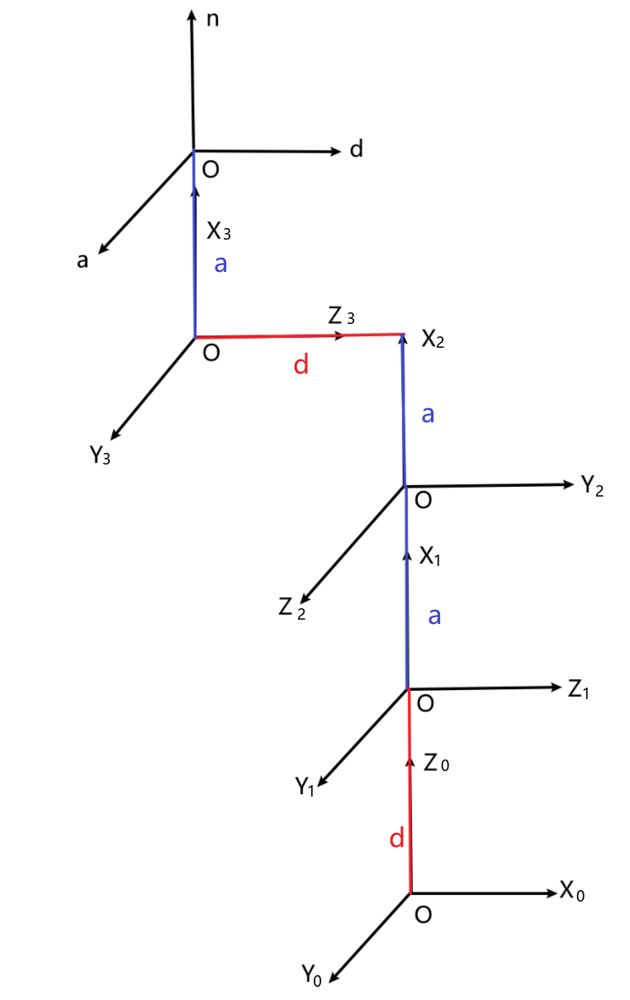
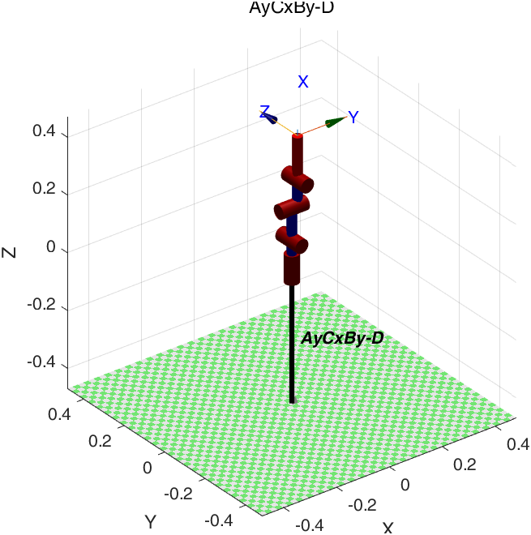
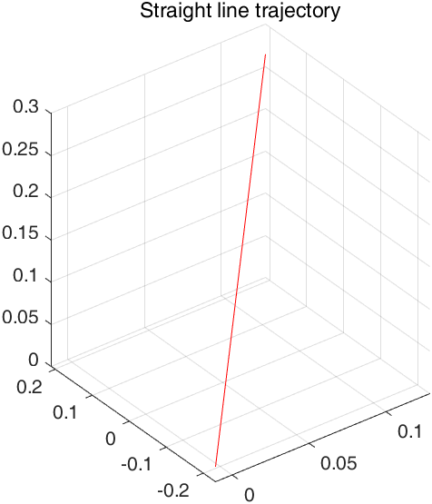

# Principe de fonctionnement

## 1. Portée

Le rapport est une étude de **statique et de cinématique**. Il décrit un bras série modulaire, énumère ses configurations d’assemblage, construit un modèle 4 DDL de Denavit–Hartenberg, échantillonne l’espace de travail et propose un indice de coût pour choisir un assemblage. Il ne contient **ni dynamique du corps rigide, ni estimation d’attitude par quaternions, ni centrale inertielle, ni preuve de stabilité en boucle fermée**. Ce document n’ajoute pas ces affirmations.

## 2. Architecture modulaire

Le bras comprend :

- une base ;
- des modules d’articulation (variantes 45° et 90°) ;
- des modules de bielle (bielle longue X-X, bielle longue X-Y, bielle courte) ;
- un effecteur terminal (pince parallèle, sonde à ultrasons, capteur de gaz ou module stylo).

L’interface mécanique est une paire tenon-mortaise inspirée des assemblages traditionnels en bois. Le dessus d’un connecteur porte un nœud « T » ; le dessous un nœud « N ». Le nœud N coulisse sur le nœud T selon l’une de deux directions perpendiculaires : l’orientation relative de deux modules est donc sélectionnable. Une vis M5 serre l’assemblage.

Le rapport abstrait chaque connexion en une chaîne **Face de connexion – Canal de connexion – Face de connexion** (FCF) :

Une bielle longue X-X ou X-Y est abstraite en 6 faces à 4 canaux ; une bielle courte en 4 faces à 4 canaux ; une articulation en 2 faces à 4 canaux. La concaténation donne une chaîne unidimensionnelle :

## 3. Nombre de combinaisons

Pour le prototype à trois modules (un module 45° et deux modules 90°), l’orientation du module adjacent à la base est fixe. Les deux autres orientations donnent \(2^2\), et les trois modules peuvent être permutés en \(3!\) ordres :

\[
N_3 = 3! \cdot 2^{3-1} = 6 \cdot 4 = 24.
\]

L’archive CAO contient exactement 24 assemblages à trois lettres et 3 modèles d’articulation seule. La formule générale (3.11) du rapport ne redonne pas 24 par substitution directe ; la dérivation est consignée dans l’[errata E-07](../errata.md).

## 4. Repères et table DH

La configuration analysée est **AyCxBy-D**, une chaîne à 4 DDL terminée par la pince parallèle. Les repères suivent la table SDH du rapport :

| \(i\) | \(\theta_i\) | \(d_i\) (mm) | \(a_i\) (mm) | \(\alpha_i\) | Plage du rapport |
|---:|---|---:|---:|---:|---|
| 1 | \(\theta_1\) | 95 | 0 | 90° | 0° |
| 2 | \(\theta_2\) | 0 | 113.5 | 90° | 0–180° |
| 3 | \(\theta_3\) | 21.34 | 88.5 | 90° | 0–180° |
| 4 | \(\theta_4\) | 0 | 152 | 0° | 0–180° |

La somme des trois longueurs de bielle vaut \(113.5 + 88.5 + 152 = 354\) mm. La portée maximale du modèle complet est d’environ **450 mm**, car les décalages \(d_1\) et \(d_3\) contribuent aussi.

## 5. Conventions de transformation

Le rapport écrit chaque transformation sous la forme

\[
T_i = \operatorname{Rot}_z(\theta_i)\,\operatorname{Rot}_x(\alpha_i)\,
\operatorname{Trans}(a_i,0,0)\,\operatorname{Trans}(0,0,d_i),
\]

ce qui place \(d_i\) dans la translation \(x/y\). La convention DH standard — celle de la Robotics Toolbox MATLAB — est

\[
T_i = \operatorname{Rot}_z(\theta_i)\,\operatorname{Trans}_z(d_i)\,
\operatorname{Trans}_x(a_i)\,\operatorname{Rot}_x(\alpha_i),
\]

qui place \(d_i\) sur l’axe \(z\). Les deux ne sont pas équivalentes. Par exemple, pour \(q=[0,90°,0,0]\), le modèle standard place l’outil à \((0{,}021;0;0{,}449)\) m, tandis que le modèle du rapport donne \((0;-0{,}074;0{,}354)\) m.

De plus, l’équation (3.7) imprime la troisième colonne de \(T_2^1\) comme nulle ; ce bloc de rotation a un déterminant nul et ne peut pas être une rotation rigide. Avec la convention du rapport, la colonne devrait être \([\sin\theta_2,-\cos\theta_2,0]^T\). Voir l’[errata E-01/E-02](../errata.md) et la [vérification](../verification.md).

## 6. Cinématique directe et espace de travail

La cinématique directe s’écrit

\[
T_4^0(q) = T_1^0(\theta_1)T_2^1(\theta_2)T_3^2(\theta_3)T_4^3(\theta_4).
\]

Avec les limites MATLAB \((0°,0°)\), \((0°,180°)\), \((-90°,90°)\), \((-90°,90°)\), 10 000 tirages uniformes donnent la boîte englobante suivante (DH standard, calculée par `scripts/verify_theory/`) :

| Axe | Plage |
|---|---:|
| x | -0,353 … 0,354 m |
| y | -0,240 … 0,240 m |
| z | -0,076 … 0,449 m |
| portée maximale | 0,450 m |

La table 3-20 du rapport donne \((0°,180°)\) pour les articulations 3 et 4 ; les scripts MATLAB utilisent \((-90°,90°)\). Ce conflit modifie l’enveloppe et est marqué `[待确认]` dans l’errata. La boîte aléatoire n’est ni un espace mesuré ni une frontière complète.

## 7. Planification de trajectoire

Les scripts MATLAB utilisent `jtraj`, un polynôme quintique dans l’espace articulaire, et `ctraj` pour une ligne droite cartésienne. Le rapport montre les courbes de position, vitesse et accélération de chaque articulation. Ce sont des **sorties de simulation**, pas des mesures d’encodeur.

## 8. Indice d’« énergie » et optimisation de l’espace de travail

Le rapport propose

\[
E_{sum} = \sum_{i=1}^{N_{Var}} \int_0^t \left|\ddot{\theta}_i(\tau)\right| d\tau
\]

comme indice d’« énergie ». Le panneau utilise la dérivée première, \(\left|\dot{\theta}_i\right|\). Aucun des deux intégrandes ne contient de couple, d’inertie ou de rendement : ce n’est pas une énergie, mais un **indicateur d’effort cinématique**. L’archive ne contient ni boucle sur les 24 assemblages ni implémentation de ce coût ; `Optimization.m` est un visualiseur de posture MediaPipe. Le dépôt qualifie donc la méthode de proposée, non démontrée. Voir l’[errata E-08](../errata.md).

La partie espace de travail compare quatre assemblages (AyCxBy-D, AyCyBx-D, AyCxBx-D, AyCyBy-D) et choisit celui qui convient à la tâche. Le rapport montre les nuages de points mais ne donne ni critère scalaire ni essai mesuré.

## 9. Statique et analyse par éléments finis

L’étude statique utilise la résine photopolymère 9400A :

| Propriété | Valeur |
|---|---:|
| Module d’Young | 2,75 GPa |
| Coefficient de Poisson | 0,44 |
| Masse volumique | 1150 kg/m³ |
| Résistance en traction | 28 MPa |
| Résistance en compression | 70 MPa |

Une charge de 10 N est appliquée sur chaque face supérieure d’articulation ; la base est encastrée. La conclusion du rapport est qualitative : le bras « peut fonctionner normalement » et le déplacement reste « dans une plage acceptable ». Le texte ne donne ni contrainte maximale, ni déplacement maximal, ni coefficient de sécurité.

Une charge de 10 N à 354 mm vaut 3,54 N·m ; à la portée modèle de 450 mm, elle vaut 4,50 N·m. Un servomoteur de 15 kgf·cm cale à 1,47 N·m. La charge est appliquée sur les faces d’articulation, pas nécessairement en pointe ; la marge de l’actionneur doit néanmoins être explicitée avant d’accepter la conclusion. Voir l’[errata E-09](../errata.md).

## 10. Ce qui n’est pas modélisé

- Dynamique du corps rigide, couplage inertiel et couple de gravité.
- Frottement, jeu, compliance et dynamique des servomoteurs ou moteurs pas à pas.
- Estimation d’attitude par quaternions ou fusion de centrale inertielle.
- Commande en boucle fermée, réglage PID et stabilité.
- Charge utile, répétabilité, masse et puissance mesurées.

Ce sont des travaux futurs, pas des résultats acquis.
